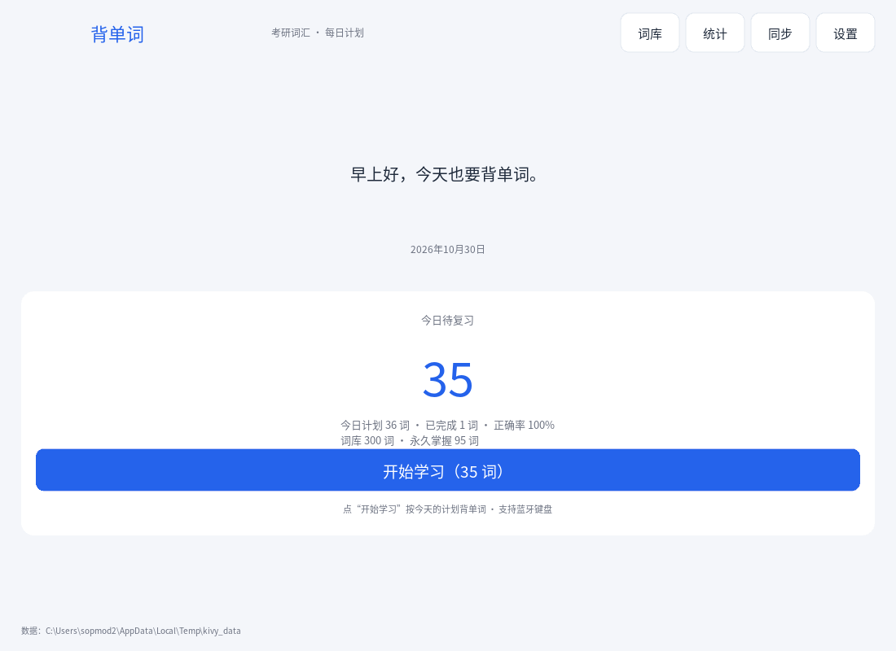
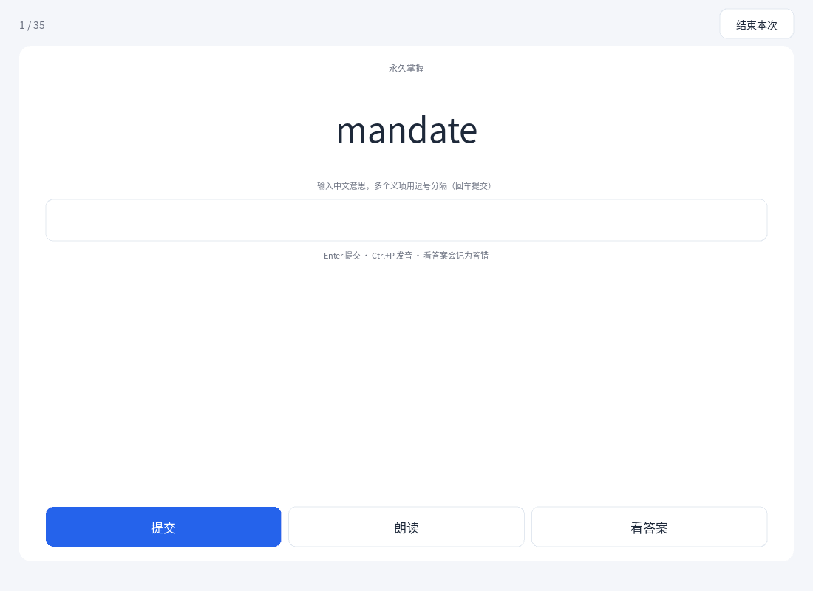
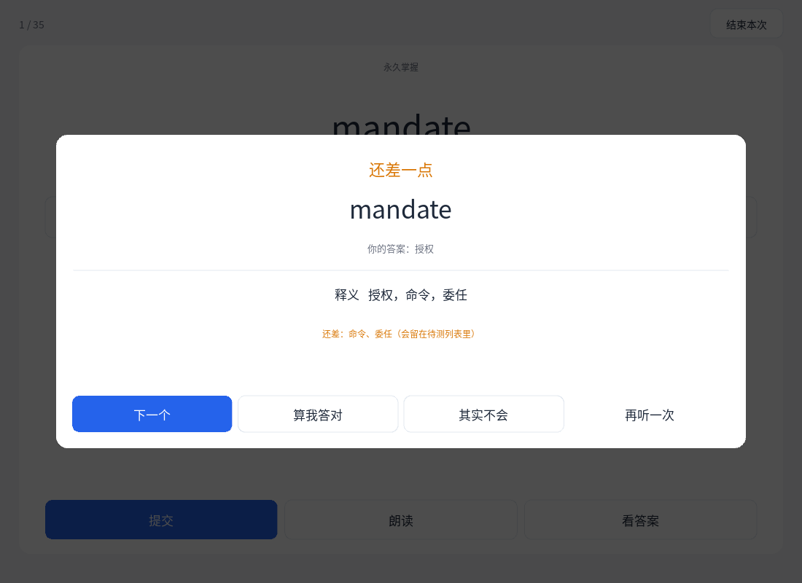
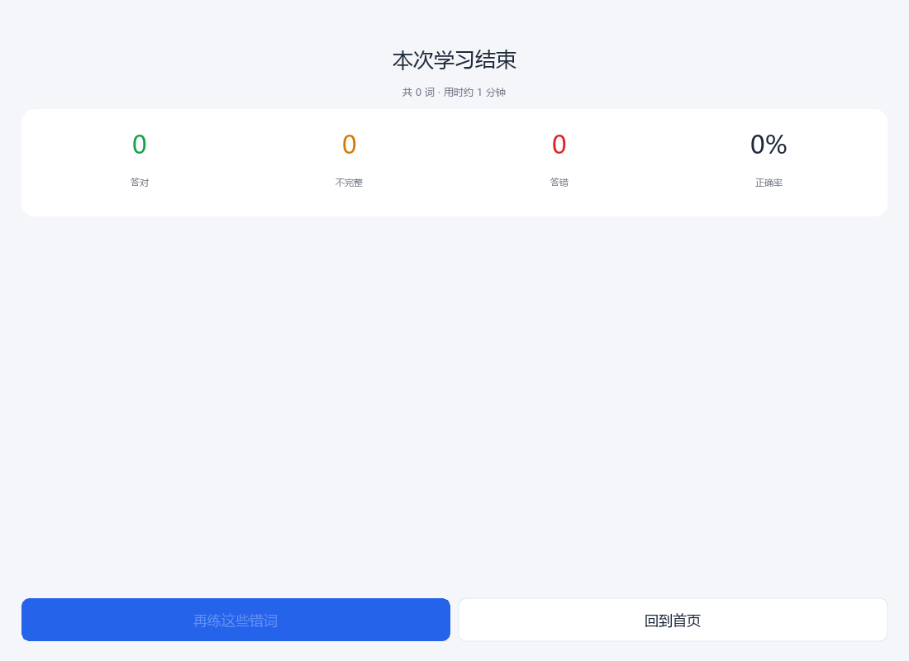
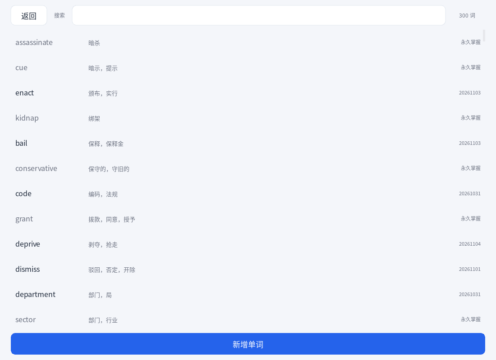
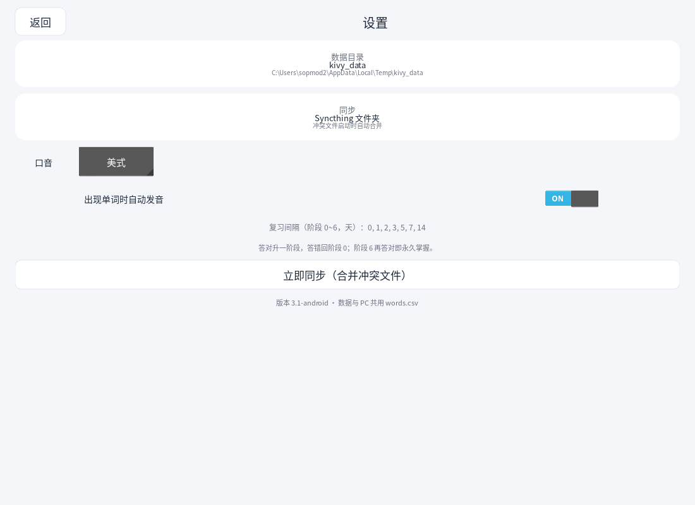
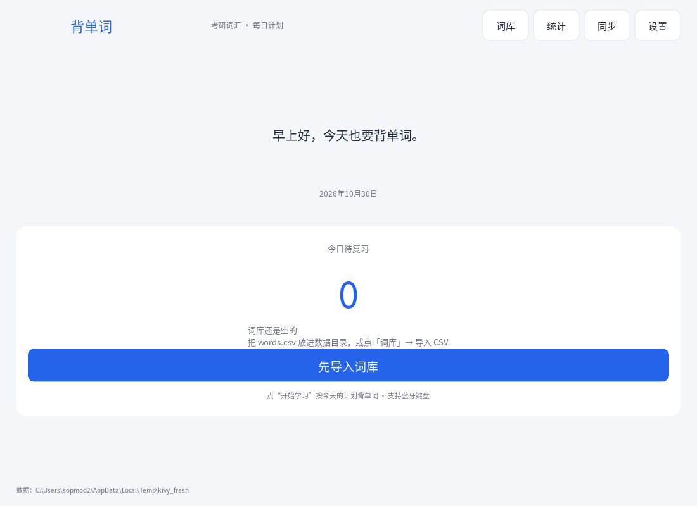
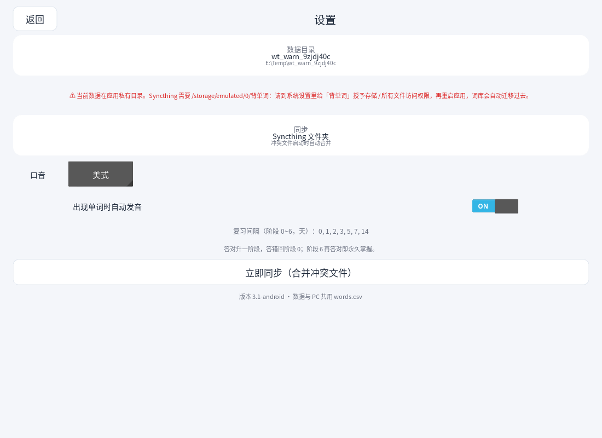

# 背单词 · 安卓版（Kivy）

把桌面的「背单词 V3」搬到安卓平板上：给单词 → 输入中文意思 → 三档判定（答对 / 还差一点 / 答错），
沿用同一套 `words.csv` 词库、阶段复习和每日计划；PC 与平板通过 **Syncthing** 同步进度。

Kivy 只负责界面，数据层 `wt_core.py` 与桌面版同源，所以两端的判定、间隔、计划规则完全一致。

---

## 一、先在本机（Windows）跑起来

```powershell
pip install kivy==2.3.1 requests
python main.py
```

* 首次启动会在 `word_trainer_kivy\data\` 下建一个空词库；
* 想直接用现有词库：把 `G:\point\考研\words.csv` 复制到 `word_trainer_kivy\data\words.csv`，
  再把 `G:\point\考研\READ` 复制到 `word_trainer_kivy\data\READ`；
* 也可以用 `--csv` 指定词库路径：

```powershell
python main.py --csv "G:\point\考研\words.csv"
```

桌面调试快捷键（平板接蓝牙键盘同样可用）：`Enter` 提交 / 下一题、`Ctrl+P` 发音、
`Ctrl+N` 打开词库、`1` 算我答对、`2` 其实不会、`Esc` 或安卓返回键结束本次。

---

## 二、打包 APK（二选一）

> 安卓 APK 必须在 Linux 上构建（Buildozer / python-for-android 的限制），
> Windows 本机不能直接出包，所以推荐用 GitHub 的免费 Linux 机器构建。

### 方案 A：GitHub Actions（推荐，不用装环境）

> 本目录**已经是一个提交好的 git 仓库**（含 `.github/workflows/build-apk.yml`），
> 不需要 `git init`，只差推送到你的 GitHub 账号。

**A1. 创建空仓库**

登录 GitHub → 右上角 **+ → New repository** → 名字例如 `beidanci` →
不要勾选 “Add a README file” → Create repository。

**A2. 推送（二选一）**

- 方式 1（最简单）：安装 [GitHub Desktop](https://desktop.github.com/) →
  `File → Add local repository` → 选本目录 → 点 **Publish repository** → 取消勾选
  “Keep this code private” 或保持私有都行 → Publish。
- 方式 2（命令行）：双击本目录的 `推送.ps1`（或右键“使用 PowerShell 运行”），
  按提示粘贴仓库地址即可。脚本会自动找到便携版 git；GitHub 现在不接受账号密码，
  需要先到 <https://github.com/settings/tokens> 生成一个 **classic token**（勾选 `repo`），
  推送时粘贴 token 作为密码。

> 便携版 git 在 `..\tools\MinGit\cmd\git.exe`；也可以自己装 Git for Windows。

**A3. 让 Actions 打出 APK**

打开仓库页面 → **Actions** → 左侧 `build-apk` → 右侧 **Run workflow** → 绿色按钮。
第一次约 20~40 分钟（要下载 Android SDK/NDK），跑完后进入这次运行，
在页面底部 **Artifacts** 下载 `beidanci-apk`，解压得到 `*.apk`。

> 以后改了代码，只要再 `push`（或 GitHub Desktop 里 Commit + Push）就会自动重新打包含。

> 仓库里还有一个 `tests` 工作流：每次 push 会先跑 34 个单元测试（约 1 分钟）。
> 构建失败时先看它是否通过，能快速区分是逻辑问题还是打包环境问题。

### 方案 B：本地 Linux / WSL / Docker

```bash
pip install buildozer cython
buildozer android debug        # 首次约 30~60 分钟
# 产物：bin/beidanci-3.1.0-arm64-v8a-debug.apk
```

也可以直接用 Kivy 官方的 buildozer 镜像：

```bash
docker run --rm -v "$PWD":/home/user/hostcwd kivy/buildozer android debug
```

---

## 三、装到平板（华为 MatePad Pro 2021）

1. 把 APK 传到平板（数据线 / 华为分享 / 网盘都行）。
2. 设置 → 安全 → **更多安全设置 → 外部来源应用下载**，允许文件管理器安装。
3. 安装后第一次打开，Android 11+ 会要 **「所有文件访问权限」**；Android 10 / 鸿蒙 2
   只要 **「存储」权限**。请允许——应用要把词库放在 `/storage/emulated/0/背单词`，
   Syncthing 才能访问。
   如果误点了拒绝：设置 → 应用 → 背单词 → 权限 里打开，然后**重启应用**；
   之前暂存在应用私有目录里的词库会自动迁移到 `/storage/emulated/0/背单词`
   （没授权时设置页会显示红色提示）。
4. 首次启动会在 `/storage/emulated/0/背单词/` 建好 `words.csv`、`READ/`、`audio/`。

> 华为鸿蒙对后台和自启动限制较严，Syncthing 想稳定同步，建议在
> 设置 → 应用启动管理 里把 Syncthing 设为「手动管理」，并允许后台活动。

---

## 四、PC ↔ 平板 同步（Syncthing）

1. PC 和平板都安装 Syncthing（PC 用 Syncthing Windows 版，平板在应用市场搜 Syncthing）。
2. 两端互相添加设备（设备 ID + 接受请求）。
3. 在 PC 上添加文件夹：
   * 文件夹路径：`G:\point\考研`
   * 文件夹 ID：`beidanci`
   * 共享给平板设备。
4. 平板上接受这个文件夹，路径选 `/storage/emulated/0/背单词`。
5. 等两端都显示「最新」即可。

同步内容：

| 文件 | 是否同步 | 说明 |
| --- | --- | --- |
| `words.csv` | ✅ | 词库与复习进度，核心文件 |
| `READ/*.mp3` | ✅ | 本地发音库，双向同步 |
| `audio/*.mp3` | ⚠️ | 平板下载的缓存，可不同步（省流量） |
| `daily_plan_tablet.json` / `daily_plan_pc.json` | ❌ | 每台设备各自生成当天计划 |
| `study_log_tablet.txt` / `study_log_pc.txt` | ❌ | 各自统计，避免互相覆盖 |
| `settings_tablet.json` / `settings_pc.json` | ❌ | 口音、自动发音等本机偏好 |

**冲突处理**：两端同时改 `words.csv` 时 Syncthing 会生成
`words.sync-conflict-*.csv`；应用每次启动会自动按 `updated_at` 合并，然后删掉冲突文件。

**使用建议**：同一时间只在一台设备上答题；答完等 Syncthing 同步完成再换设备。
`words.csv` 新增了 `updated_at`、`deleted` 两列（桌面 V3 会原样保留，不影响使用）。

---

## 开发自检（可选）

```powershell
python -m unittest test_core test_sync      # 34 个逻辑/同步测试
python check_android_static.py              # 安卓兼容性静态检查
python check_apk_files.py                   # 按 buildozer.spec 检查哪些文件会进 APK
python check_android_paths.py               # 模拟没有存储权限时的回退逻辑
```

## 界面截图

| 首页 | 答题 | 判定（还差一点） |
| --- | --- | --- |
|  |  |  |

| 判定（答错） | 总结 | 词库 |
| --- | --- | --- |
|  |  |  |

| 设置 | 首次启动（空词库） | 未授权存储时的提示 |
| --- | --- | --- |
|  |  |  |

---

## 五、目录结构

```
word_trainer_kivy/
├─ main.py              # Kivy 界面（首页 / 答题 / 判定弹窗 / 总结 / 词库 / 设置）
├─ wt_core.py           # 数据层：CSV、阶段复习、三档判定、每日计划（与桌面 V3 同源）
├─ sync.py              # Syncthing 冲突合并 + 软删除墓碑
├─ audio.py             # 发音：READ 本地优先 → 有道下载 → SoundLoader / MediaPlayer
├─ test_core.py         # 30 个数据层单测
├─ test_sync.py         # 3 个同步单测
├─ buildozer.spec       # 安卓打包配置（arm64-v8a，兼容 Android 7+）
├─ .github/workflows/build-apk.yml   # GitHub Actions 自动打包
├─ assets/icon.png      # 桌面图标
├─ assets/NotoSansSC-Regular.ttf     # 中文字体（打包进 APK）
└─ screenshots/         # 界面截图
```

---

## 六、数据格式

`words.csv`（UTF-8 BOM，逗号分隔，表头固定）：

| 列 | 含义 |
| --- | --- |
| `word` | 单词 |
| `meaning` | 中文释义，多个义项用 `，` `,` `、` `;` 分隔 |
| `review_stage` | 复习阶段 0~6 |
| `next_review` | 下次复习日期 `YYYY-MM-DD` |
| `permanent` | 是否永久掌握（True/False） |
| `today_correct` | 今天是否已答对 |
| `record_date` | 最近一次答题日期 `YYYY-MM-DD` |
| `updated_at` | 最后修改时间（epoch 秒，同步用） |
| `deleted` | 软删除标记（1 = 已删除） |

---

## 七、常见问题

* **没有声音**：先确认 `READ/单词.mp3` 存在；没有的话应用会用有道的在线发音（需要联网）。
  安卓上若 SDL2 播放失败会自动退回系统 MediaPlayer。
* **设置页提示「数据在应用私有目录」**：没有拿到存储权限，Syncthing 看不到词库。
  去系统设置给「背单词」授予存储 / 所有文件访问权限，然后重启应用，词库会自动迁移。
* **中文显示成方块**：确认 `assets/NotoSansSC-Regular.ttf` 被打进 APK（`buildozer.spec` 已包含 `assets/*`）。
* **构建失败**：Actions 第一次构建常因下载 NDK 超时，重新 Run workflow 即可；
  本地构建请确保磁盘 ≥ 15GB。
* **删除单词**：应用内删除是软删除，会同步到另一台设备；彻底清理可手动删 CSV 里 `deleted=1` 的行。
* **桌面版 V3 与平板**：两端共用 `words.csv`；V3 已经是同步版（保留 `deleted` /
  `updated_at` 列），在任意一端删除都会同步到另一端。
